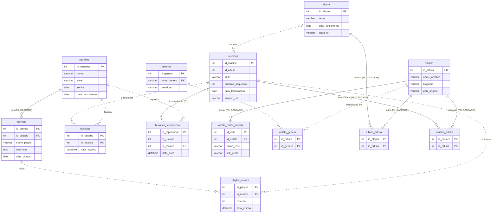

<div align="center">

# 🎧 NOIR

### Banco de Dados para uma Plataforma de Streaming Musical


**Atividade III · SEDUC DEST2**
*Planejar, criar e testar um banco de dados para um domínio qualquer.*

> *NOIR — Música organizada, dados conectados.*

</div>

---

## 📑 Sumário

1. [Sobre o projeto](#-1-sobre-o-projeto)
2. [Por que um banco relacional?](#-2-por-que-um-banco-relacional)
3. [Modelo de dados (diagrama)](#-3-modelo-de-dados)
4. [Regras de integridade](#-4-regras-de-integridade)
5. [Normalização](#-5-normalização)
6. [Consultas SQL](#-6-consultas-sql)
7. [Como executar](#-7-como-executar)
8. [Conclusão](#-8-conclusão)

---

## 🎵 1. Sobre o projeto

O **NOIR** é um banco de dados relacional para uma plataforma **fictícia** de streaming musical. Ele organiza:

| 👤 Pessoas | 🎤 Catálogo | 🎶 Uso da plataforma |
|---|---|---|
| Usuários | Artistas, gêneros e redes sociais | Playlists |
| | Álbuns e músicas | Favoritos |
| | | Histórico de reprodução |

**Estado atual dos scripts:** os arquivos `.sql` (gerados com *mysqldump* em 04/11/2026) contêm a **estrutura** das 13 tabelas. As tabelas ainda **não possuem registros**; os dados devem ser inseridos para testar as consultas.

---

## 🧩 2. Por que um banco relacional?

<table>
<tr>
<th width="50%">❌ Sem um SGBD relacional</th>
<th width="50%">✅ Com o NOIR em MySQL</th>
</tr>
<tr>
<td>

- **Desorganização:** dados espalhados
- **Duplicidade:** usuários, artistas e músicas repetidos
- **Perda de informação:** dados difíceis de proteger
- **Consultas difíceis:** buscar músicas e playlists é trabalhoso
- **Inconsistência:** registros divergentes
- **Manutenção complicada:** atualizar é custoso

</td>
<td>

- **Organização:** uma tabela para cada assunto
- **Integridade:** chaves primárias, estrangeiras e `CHECK`
- **Menos redundância:** relações N:N em tabelas próprias
- **Consultas eficientes:** `JOIN`, agregações e filtros
- **Histórico:** reproduções registradas por usuário
- **Manutenção facilitada:** controle centralizado

</td>
</tr>
</table>

---

## 🗺️ 3. Modelo de dados

> **Legenda:** linha **contínua** = chave estrangeira (`FOREIGN KEY`) declarada no script · linha **pontilhada** = relação lógica, **sem** `FOREIGN KEY` declarada no script (ver [seção 8](#-8-observações-técnicas-e-melhorias)).



---

## 🛡️ 4. Regras de integridade

### Chaves estrangeiras declaradas nos scripts

| Tabela filha | Coluna | Tabela pai | `ON DELETE` | `ON UPDATE` |
|---|---|---|---|---|
| `playlists` | `id_usuario` | `usuarios` | `CASCADE` | `CASCADE` |
| `artista_redes_sociais` | `id_artista` | `artistas` | `CASCADE` | `CASCADE` |
| `album_artista` | `id_album` | `albuns` | `CASCADE` | `CASCADE` |
| `album_artista` | `id_artista` | `artistas` | `CASCADE` | `CASCADE` |
| `musica_artista` | `id_musica` | `musicas` | `CASCADE` | `CASCADE` |
| `musica_artista` | `id_artista` | `artistas` | `CASCADE` | `CASCADE` |
| `historico_reproducao` | `id_musica` | `musicas` | *(padrão: restringe)* | *(padrão: restringe)* |

### Outras restrições

| Tipo | Onde | Regra |
|---|---|---|
| `UNIQUE` | `generos.nome_genero` | Não existem dois gêneros com o mesmo nome |
| `UNIQUE` | `artista_redes_sociais (id_artista, nome_rede)` | Uma rede por artista |
| `UNIQUE` | `playlist_musica (id_playlist, posicao)` | Posição única dentro da playlist |
| `CHECK` | `musicas.duracao_segundos` | Deve ser maior que 0 |
| `CHECK` | `playlist_musica.posicao` | Deve ser maior que 0 |
| `DEFAULT` | `playlist_musica.data_adicao`, `favoritos.data_favorito`, `historico_reproducao.data_hora` | `CURRENT_TIMESTAMP` |

---

## 📐 5. Normalização

| Forma Normal | Como aparece no NOIR |
|---|---|
| **1FN** | Cada campo guarda um único valor. Gêneros, redes sociais e músicas de playlists ficam em tabelas próprias, sem listas dentro de uma coluna. |
| **2FN** | Nas tabelas de chave composta (`musica_artista`, `album_artista`, `artista_genero`, `playlist_musica`, `favoritos`), os atributos dependem da chave inteira. Título da música e nome artístico ficam nas suas próprias tabelas. |
| **3FN** | Nome e descrição do gênero ficam em `generos`; dados do artista ficam em `artistas`. Não há atributos descrevendo outros atributos não-chave. |
| **4FN** | Gêneros (`artista_genero`) e redes sociais (`artista_redes_sociais`) são fatos multivalorados independentes do artista e ficam separados, evitando combinações redundantes. |

> ℹ️ A confirmação formal de cada forma normal depende da análise das dependências funcionais e multivaloradas do modelo. A separação em tabelas contribui para a normalização, mas não substitui essa verificação.

---

## 🔎 6. Consultas SQL

As consultas abaixo foram escritas com base na estrutura real dos scripts. Os resultados dependem dos registros inseridos, então execute-as no **MySQL Workbench** depois de popular o banco.

### 🎶 Catálogo

<details>
<summary><b>6.1 · Listar músicas e seus álbuns</b></summary>

*Exibe o catálogo e o álbum de cada música. O `LEFT JOIN` mantém músicas sem álbum.*

```sql
USE noir;

SELECT m.id_musica,
       m.titulo AS musica,
       a.titulo AS album,
       m.data_lancamento,
       m.duracao_segundos
FROM musicas AS m
LEFT JOIN albuns AS a ON m.id_album = a.id_album
ORDER BY m.titulo;
```
</details>

<details>
<summary><b>6.2 · Pesquisar artistas pelo nome</b></summary>

*Retorna artistas cujo nome contém a letra "a". Troque o termo entre `%` para outra busca.*

```sql
SELECT id_artista, nome_artistico, pais_origem
FROM artistas
WHERE nome_artistico LIKE '%a%'
ORDER BY nome_artistico;
```
</details>

<details>
<summary><b>6.3 · Gêneros associados a cada artista</b></summary>

*O `INNER JOIN` retorna apenas associações existentes.*

```sql
SELECT ar.nome_artistico, g.nome_genero
FROM artistas AS ar
INNER JOIN artista_genero AS ag ON ar.id_artista = ag.id_artista
INNER JOIN generos AS g         ON ag.id_genero  = g.id_genero
ORDER BY ar.nome_artistico, g.nome_genero;
```
</details>

<details>
<summary><b>6.4 · Contar artistas por gênero</b></summary>

*`COUNT` + `GROUP BY`. Gêneros sem artistas aparecem com 0.*

```sql
SELECT g.nome_genero,
       COUNT(ag.id_artista) AS quantidade_artistas
FROM generos AS g
LEFT JOIN artista_genero AS ag ON g.id_genero = ag.id_genero
GROUP BY g.id_genero, g.nome_genero
ORDER BY quantidade_artistas DESC, g.nome_genero;
```
</details>

<details>
<summary><b>6.5 · Músicas com mais de três minutos</b></summary>

```sql
SELECT titulo, duracao_segundos
FROM musicas
WHERE duracao_segundos > 180
ORDER BY duracao_segundos DESC;
```
</details>

<details>
<summary><b>6.6 · Contar músicas por álbum</b></summary>

*Inclui álbuns sem músicas cadastradas.*

```sql
SELECT a.titulo AS album,
       COUNT(m.id_musica) AS quantidade_musicas
FROM albuns AS a
LEFT JOIN musicas AS m ON a.id_album = m.id_album
GROUP BY a.id_album, a.titulo
ORDER BY quantidade_musicas DESC, a.titulo;
```
</details>

### 👤 Usuários

<details>
<summary><b>6.7 · Usuários nascidos a partir do ano 2000</b></summary>

```sql
SELECT id_usuarios, nome, email, data_nascimento
FROM usuarios
WHERE data_nascimento >= '2000-01-01'
ORDER BY data_nascimento;
```
</details>

<details>
<summary><b>6.8 · Usuários sem reproduções registradas</b></summary>

*`LEFT JOIN` + `IS NULL` para achar quem nunca ouviu nada.*

```sql
SELECT u.id_usuarios, u.nome, u.email
FROM usuarios AS u
LEFT JOIN historico_reproducao AS h ON u.id_usuarios = h.id_usuario
WHERE h.id_reproducao IS NULL
ORDER BY u.nome;
```
</details>

### ▶️ Reproduções

<details>
<summary><b>6.9 · Histórico de reprodução (mais recente primeiro)</b></summary>

```sql
SELECT u.nome AS usuario,
       m.titulo AS musica,
       h.data_hora
FROM historico_reproducao AS h
INNER JOIN usuarios AS u ON h.id_usuario = u.id_usuarios
INNER JOIN musicas  AS m ON h.id_musica  = m.id_musica
ORDER BY h.data_hora DESC;
```
</details>

<details>
<summary><b>6.10 · Contar reproduções por usuário</b></summary>

```sql
SELECT u.nome AS usuario,
       COUNT(h.id_reproducao) AS total_reproducoes
FROM usuarios AS u
LEFT JOIN historico_reproducao AS h ON u.id_usuarios = h.id_usuario
GROUP BY u.id_usuarios, u.nome
ORDER BY total_reproducoes DESC, u.nome;
```
</details>

<details>
<summary><b>6.11 · Músicas mais reproduzidas</b></summary>

```sql
SELECT m.titulo AS musica,
       COUNT(h.id_reproducao) AS total_reproducoes
FROM musicas AS m
LEFT JOIN historico_reproducao AS h ON m.id_musica = h.id_musica
GROUP BY m.id_musica, m.titulo
ORDER BY total_reproducoes DESC, m.titulo;
```
</details>

<details>
<summary><b>6.12 · Reproduções em 2026</b></summary>

*`BETWEEN` considera os dois limites. Aproveita o índice `idx_historico_usuario_data` quando combinado com `id_usuario`.*

```sql
SELECT id_reproducao, id_usuario, id_musica, data_hora
FROM historico_reproducao
WHERE data_hora BETWEEN '2026-01-01 00:00:00'
                    AND '2026-12-31 23:59:59'
ORDER BY data_hora;
```
</details>

<details>
<summary><b>6.13 · Tempo total reproduzido por usuário</b></summary>

*`SUM` soma as durações; `COALESCE` devolve 0 para quem não tem reproduções.*

```sql
SELECT u.nome AS usuario,
       COALESCE(SUM(m.duracao_segundos), 0) AS total_segundos_reproduzidos
FROM usuarios AS u
LEFT JOIN historico_reproducao AS h ON u.id_usuarios = h.id_usuario
LEFT JOIN musicas AS m              ON h.id_musica   = m.id_musica
GROUP BY u.id_usuarios, u.nome
ORDER BY total_segundos_reproduzidos DESC;
```
</details>

### ⭐ Favoritos

<details>
<summary><b>6.14 · Músicas favoritas dos usuários</b></summary>

```sql
SELECT u.nome AS usuario,
       m.titulo AS musica,
       f.data_favorito
FROM favoritos AS f
INNER JOIN usuarios AS u ON f.id_usuario = u.id_usuarios
INNER JOIN musicas  AS m ON f.id_musica  = m.id_musica
ORDER BY u.nome, m.titulo;
```
</details>

<details>
<summary><b>6.15 · Contar favoritos por música</b></summary>

```sql
SELECT m.titulo AS musica,
       COUNT(f.id_usuario) AS total_favoritos
FROM musicas AS m
LEFT JOIN favoritos AS f ON m.id_musica = f.id_musica
GROUP BY m.id_musica, m.titulo
ORDER BY total_favoritos DESC, m.titulo;
```
</details>

**Recursos SQL utilizados:** `SELECT` · `WHERE` · `LIKE` · `BETWEEN` · `INNER JOIN` · `LEFT JOIN` · `GROUP BY` · `ORDER BY` · `COUNT` · `SUM` · `COALESCE` · `IS NULL`.

---

## 🚀 7. Como executar

Cada tabela tem seu próprio script `noir_<tabela>.sql`. Os scripts **não criam o banco**, então crie-o antes.

```sql
CREATE DATABASE IF NOT EXISTS noir
  CHARACTER SET utf8mb4 COLLATE utf8mb4_0900_ai_ci;
USE noir;
```

**Ordem recomendada de importação** (tabelas pai antes das filhas):

| Etapa | Scripts |
|---|---|
| 1️⃣ Base | `noir_usuarios` · `noir_artistas` · `noir_generos` · `noir_albuns` · `noir_musicas` |
| 2️⃣ Dependentes | `noir_playlists` · `noir_artista_redes_sociais` · `noir_album_artista` · `noir_musica_artista` |
| 3️⃣ Associações e uso | `noir_artista_genero` · `noir_playlist_musica` · `noir_favoritos` · `noir_historico_reproducao` |

```bash
mysql -u root -p noir < noir_usuarios.sql
```

> 💡 Os dumps desativam temporariamente a verificação de chaves estrangeiras durante a importação, mas seguir a ordem acima evita problemas se você executar os `CREATE TABLE` manualmente.

No **MySQL Workbench**: *Server → Data Import → Import from Self-Contained File* e escolha o schema `noir`.

---

## 🏁 8. Conclusão

O **NOIR** mostra como um banco relacional organiza uma plataforma de streaming musical. Com **13 tabelas**, o modelo cobre usuários, artistas, gêneros, redes sociais, álbuns, músicas, playlists, favoritos e histórico de reprodução.

Chaves primárias e estrangeiras, restrições `UNIQUE` e `CHECK`, valores padrão e um índice de histórico garantem consistência e bom desempenho. A separação em tabelas de associação aplica os princípios de normalização.

O próximo passo natural é popular o banco, aplicar as melhorias da seção 8 e integrá-lo a uma aplicação **Java** conectada ao MySQL.

<div align="center">

---

**🎧 NOIR — Música organizada, dados conectados.**

</div>
